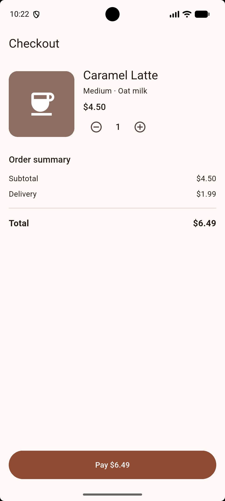

# SizedBox Widget Demo

**SizedBox** is a Flutter widget that gives its child a fixed width and/or height, or adds empty space when it has no child.

This demo is a coffee shop checkout screen. SizedBox is used to keep the product image at a fixed size, add spacing between sections, keep the quantity number from shifting, and make the Pay button full width.

## Screenshot



## How to run

1. Install Flutter and start an Android emulator (or plug in a phone).
2. Clone this repo and open the folder.
3. Run:
   ```
   flutter pub get
   flutter run
   ```

## The three properties

| Property | Default | What it changes | Why use it |
|---|---|---|---|
| `width` | `null` (box takes the child's width) | Sets how wide the box is. `double.infinity` makes it as wide as the parent allows. | Full-width buttons, fixed-width labels. In the demo the Pay button uses `width: double.infinity`. |
| `height` | `null` (box takes the child's height) | Sets how tall the box is. | Consistent button heights and bigger tap targets. The Pay button uses `height: 52`. |
| `child` | `null` (box is empty) | With no child the box is just empty space. With a child, the child is forced to the box's size. | `SizedBox(height: 24)` is used as a spacer; the product image is put inside a `SizedBox(width: 120, height: 120)`. |

## Where SizedBox is used in the code

All uses are in `lib/screens/checkout_screen.dart` and marked with comments:

- **#1** fixed 120 × 120 product image
- **#2** horizontal space between the image and text
- **#3** vertical space between sections
- **#4** fixed-width quantity number so the buttons don't move
- **#5** full-width Pay button

## Reference

- Flutter docs: [SizedBox class](https://api.flutter.dev/flutter/widgets/SizedBox-class.html)
